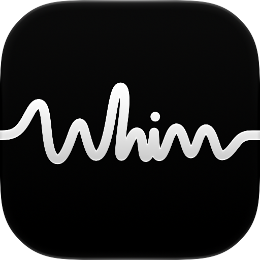

<p align="center">
  
</p>

<h1 align="center">Whim</h1>

<p align="center">
  Record voice Notes on iPhone and Apple Watch.<br>
  Send them to a webhook you control.
</p>

<p align="center">
  <a href="docs/receive-audio.md">Set up your receiver</a> ·
  <a href="docs/webhook-contract-v1.md">Webhook contract</a> ·
  <a href="#development">Development</a> ·
  <a href="docs/privacy.md">Privacy</a>
</p>

Whim saves your recordings on your devices and sends the audio and metadata directly to your chosen server. It has no accounts, hosted audio storage, analytics, or telemetry. Both apps use SwiftUI. The iPhone app requires iOS 18 or later, and the Watch app requires watchOS 11 or later.

## How it works

1. Start recording on your iPhone or Apple Watch. You can also start with Siri, App Shortcuts, the iPhone Lock Screen control, or a supported Action button.
2. Tap Stop to save a Note. Whim keeps the audio locally and starts delivery when you have a webhook configured and a connection.
3. Your webhook receives an `.m4a` recording and JSON metadata. Use your server to store or process them. The included receiver verifies signed requests and saves each Note once, even when both devices send it.

You can record offline or skip webhook setup. Unsent Notes stay on your device. History shows delivery status and lets you play a Note, inspect a failure, or retry delivery.

When enabled and available, on-device speech recognition generates short titles. Whim does not store full transcripts or use a server to generate titles. Apple Watch records independently and transfers Notes to your paired iPhone.

You choose how long to keep audio after successful delivery. The default is 30 days, and unsent Notes do not expire. Recordings can last up to five minutes.

## Receive your audio

Follow the [audio receiver setup guide](docs/receive-audio.md) to run the included receiver, connect Whim, and retrieve your recordings. Choose a local Wi-Fi setup or a persistent Linux service with HTTPS, authentication, and backups.

The receiver requires Node 24 or newer. You do not need Xcode or Apple development tools to run it. To build your own receiver, follow the [webhook contract](docs/webhook-contract-v1.md).

## Development

Install Xcode with iOS 18+ and watchOS 11+ support, Node 24 or newer, and Maestro for iPhone end-to-end tests.

`WhimCore` owns recording, persistence, delivery, recovery, and device synchronization. The iPhone and Watch apps call it through native presentation models.

Open `ios/Whim.xcworkspace` and run the `Whim` or `WhimWatch` scheme. Xcode resolves Swift Package Manager dependencies. Set your signing team for physical devices and preserve the checked-in bundle IDs and app-group entitlements.

```sh
npm ci
npm run ios
```

`npm run ios` builds, installs and launches the native iPhone simulator app. It preserves an existing installation's data. To select a simulator, set `WHIM_IPHONE_SIMULATOR_UDID`.

## Tests

```sh
npm run test:unit
eval "$(./scripts/boot-apple-simulators.sh)"
npm run test:integration
npm run test:e2e
npm run test:all
```

`test:all` selects and boots compatible simulators when their IDs are not already supplied. Unit tests need no simulator. Integration tests exercise core and presentation services and the Watch model. E2E runs native iPhone Maestro journeys and Watch XCTest journeys against isolated webhook fixtures. These journeys clear test-app data. Run them on the dedicated CI simulators.

For focused presentation checks, run `swift test` from the repository root. WhimCore tests run with `swift test --package-path packages/WhimCore`. Each package uses explicit source membership with adjacent companion tests. The Node colocation checker validates membership and prevents tests from shipping in production targets.

Run `npm run test:integration:webhook` to test the reference receiver independently on macOS or Linux. These tests also run in the root integration suite and CI.

When native view files change, run `ruby scripts/configure-xcode-project.rb` and commit the updated Xcode project. The script requires the `xcodeproj` gem. Presentation model and test membership lives in the root `Package.swift`. Shared native behavior and test membership lives in `packages/WhimCore/Package.swift`.

`npm run test-server` starts the development webhook inbox on port 8787. Its page documents URLs and signed request details.

## Project guide

| Document | What it covers |
| --- | --- |
| [Domain model](CONTEXT.md) | The terms used in code and documentation. |
| [v1 design](docs/superpowers/specs/2026-09-04-whim-v1-design.md) | App behavior, architecture, and test interfaces. |
| [Startup flow](docs/startup-flow.md) | iPhone and Watch launch timelines. |
| [Migration verification](docs/swiftui-migration-verification.md) | SwiftUI migration checks and evidence. |
| [Physical acceptance](e2e/physical/paired-device.e2e.test.md) | Checks that require a real iPhone and Apple Watch. |

## Releasing

<details>
<summary>Versioning and changelogs</summary>

[Changesets](https://github.com/changesets/changesets) owns the App Store marketing version in `ios/package.json`, under `@whim/app`. Record user-visible changes with `npm run changeset` and commit the Changeset with the change. Never edit `MARKETING_VERSION` by hand. Version 1.0.0 is the initial release and has no changelog. Xcode's distribution flow manages build numbers.

To release, use a Mac with Xcode, the simulator runtimes and Maestro required by `test:all`, installed dependencies (`npm ci`), and authenticated Git and GitHub CLI access to push main/tags and create releases. Start from a clean branch whose current commit matches the freshly fetched `origin/main`, with at least one pending app Changeset, then run:

```sh
npm run release
```

This command consumes Changesets, updates `ios/CHANGELOG.md`, the app manifest, every Xcode target's marketing version, and the npm lockfile. It runs `test:all` and `verify:release`, commits the version changes, and atomically pushes the commit to main together with an annotated `vX.Y.Z` tag. It then creates a GitHub Release using that version's changelog notes. It refuses dirty or detached checkouts, an out-of-date main, reused tags, unexpected edits, failed checks, and separate or multiple push destinations. It prepares an isolated Git index, verifies the commit against the validated tree and original parent, and pushes pinned commit/tag objects to the checked destination. It never force-pushes or discards work. Other local checkouts are left alone; update their main branch normally afterward.

The existing [Xcode Cloud Release workflow](https://appstoreconnect.apple.com/teams/3a7fa4a7-7fbd-40c9-b79c-659659e627f6/xcode-cloud/products/b675c35b-56c1-482b-b43d-ac966e431519/workflows/62dc6f87-fa57-4e9e-810a-43aa1dd13728) starts when the version tag is pushed. It archives the `Whim` scheme with its embedded Watch app and extensions for App Store Connect, manages distribution signing/build numbers, and uploads to the existing Internal TestFlight group. Wait for its build and App Store Connect processing to succeed before choosing the build for submission. App Store submission and physical acceptance remain manual. GitHub Actions is currently disabled for this repository.

For version preparation alone, `npm run release:version` updates the manifests, changelog, Xcode versions, and lockfile without committing, tagging, or publishing. Do not run it before `npm run release`; the full command performs that step itself. `npm run release -- --help` displays usage without making changes.

If a release fails, inspect its error and `git diff` first. Generated files, local commits, and tags are preserved. If version preparation completed but tests or archiving failed, fix the cause and rerun both checks, then finish the reviewed release manually. Use the release-notes path printed by the command:

```sh
npm run test:all
npm run verify:release
whim_release_version="$(node -p "require('./ios/package.json').version")"
whim_release_notes='/path/printed/by/the/command/notes.md'
git diff
git add -- ios/package.json ios/CHANGELOG.md package-lock.json ios/whim.xcodeproj/project.pbxproj .changeset
git commit -m "chore(ios): release $whim_release_version"
git tag -a "v$whim_release_version" -m "whim $whim_release_version"
git push --atomic origin HEAD:refs/heads/main "refs/tags/v$whim_release_version"
gh release create "v$whim_release_version" --repo kumibrr/whim --verify-tag \
  --title "whim $whim_release_version" --notes-file "$whim_release_notes"
```

Fetch and compare `origin/main` before finishing; if it advanced, reconcile and validate against the updated main first. If preparation itself only partially completed, repair the version/changelog consistency before finishing. If a commit or tag already exists, use the failed command's recovery instructions instead of recreating it. If commit verification failed, do not publish that commit: inspect and repair it, preserve concurrent edits, and validate again. If tagging failed after a verified commit, fix the tagging problem and use the printed command to create the tag at the recorded commit only after confirming that the tag is absent locally and remotely. Never move an existing release tag. After a push error, inspect remote refs before retrying because a lost response can hide a successful push. If only GitHub Release creation failed, the tag already triggered Xcode Cloud: check `gh release view`, then use the printed publication-only recovery command. Do not run versioning again for the same release.

</details>

<details>
<summary>Release checks and App Store submission</summary>

The [webhook contract](docs/webhook-contract-v1.md) documents signing and persistent Note-ID deduplication. The [privacy policy](docs/privacy.md) describes local processing, paired-device transfer, and user-selected endpoints. The [paired-device matrix](e2e/physical/paired-device.e2e.test.md) records the physical checks still required before release; its [test guide](e2e/physical/paired-device-test-guide.md) explains how to run and report every case.

Run `npm run verify:release` on macOS to create a clean unsigned Release device archive. The command validates all four embedded executables, privacy manifests, and submission metadata. It checks the shared marketing version and build number, lowercase `whim` display names, and the export-compliance key. The release command runs this after `test:all`. The archive defaults to `ios/build/Whim.xcarchive`. Override it with `WHIM_ARCHIVE_PATH`. Distribution signing and physical acceptance remain separate release requirements.

The iPhone E2E runner restarts its selected simulator immediately before Maestro, so it starts with a fresh automation session after native XCTest. It waits for the simulator to finish booting before starting the journeys.

Run `./scripts/check-release-privacy.sh` to check SDK references and source manifest reasons. Pass a built `whim.app` path to also inspect every embedded target's manifest. After building or archiving Release, run `./scripts/check-release-fixtures.sh /absolute/path/to/whim.app` to inspect all four executables for debug injection code. That check also requires the product-owner-approved, non-sensitive recording at `src/iphone/webhook-configuration/configuration-test.m4a`, matching the runtime configuration-test asset. The development fixture is not release approval.

If GitHub Actions is re-enabled, require both `tooling` and `apple` CI jobs in repository branch protection. The [approved configuration-test recording](docs/configuration-test-asset.md) is included. Physical sign-off, signing/provisioning, and App Store disclosure review remain prerequisites for publishing.

Publish the privacy policy at a public URL and link to it from App Store Connect and an accessible place inside the app, as required by [App Review guideline 5.1.1](https://developer.apple.com/app-store/review/guidelines/#data-collection-and-storage). Review [App Privacy answers](https://developer.apple.com/app-store/app-privacy-details/) against the actual release and endpoint arrangement. The manifest declares no tracking or app-operator collection; that declaration does not establish a user-selected webhook's collection practices. The release privacy gate checks required-reason API declarations and their presence in embedded targets.

</details>
